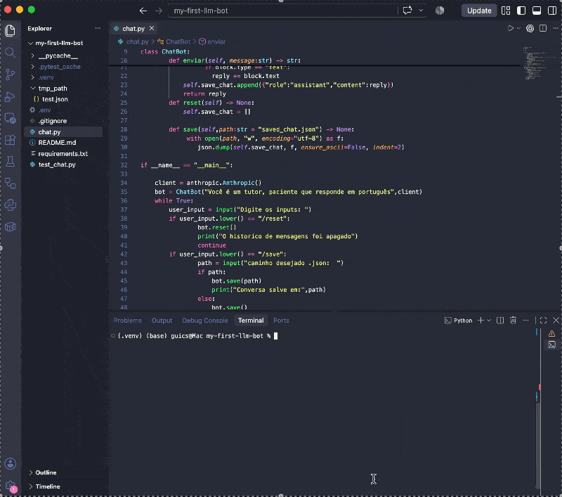

# My First LLM Bot

A command-line chatbot built with Python and the Anthropic API. It keeps the conversation history in memory, sends it with each request, and can save it as a JSON file.

## Demo

```text
Digite os inputs: oi
Oi! Tudo bem? Sou seu tutor e estou aqui para ajudar com qualquer dúvida que você tenha.
Digite os inputs: /save
caminho desejado .json:
Conversa salva em: saved_chat.json
Digite os inputs: sair
```

<!-- Replace with a real conversation from your terminal, or a GIF:  -->

## Requirements

- Python 3.10 or newer
- An Anthropic API key

## Setup

1. Create and activate a virtual environment:

   ```bash
   python -m venv .venv
   source .venv/bin/activate
   ```

2. Install the dependencies:

   ```bash
   pip install -r requirements.txt
   ```

3. Create a `.env` file in the project directory and add your API key:

   ```dotenv
   ANTHROPIC_API_KEY=your_api_key
   ```

   `.gitignore` keeps `.env`, `.venv/` and saved conversations (`*.json`) out of Git.

## Run

```bash
python chat.py
```

Type a message to chat. Commands:

| Command  | What it does |
|----------|--------------|
| `/reset` | Clears the conversation held in memory. |
| `/save`  | Asks for a file path and saves the conversation as JSON. Press Enter to use `saved_chat.json`. |
| `sair`   | Exits the program. |

The bot uses the system prompt `Você é um tutor, paciente que responde em português` and defaults to the `claude-haiku-5-5` model. Both can be changed when creating `ChatBot` in `chat.py`.

## Project structure

```text
chat.py           # ChatBot class and the command-line loop
test_chat.py      # pytest tests
requirements.txt
```

## Tests

```bash
pytest
```

The tests cover the initial empty history, `/reset`, and saving to a file. They do not call the API.

## What I Learned

<!-- Write this part yourself, in first person. Ideas:
- Turning a script into a class: what goes in __init__ vs. methods, and why save_chat is an instance variable
- Why the model needs the whole history on every request
- Writing my first pytest tests, and why `if __name__ == "__main__":` was needed for them to run
- Reading tracebacks to find bugs
-->

## Next steps

- Load a saved conversation when the bot starts.
- Stream the reply as it is generated.
- Add tests for `enviar` using a fake client.
